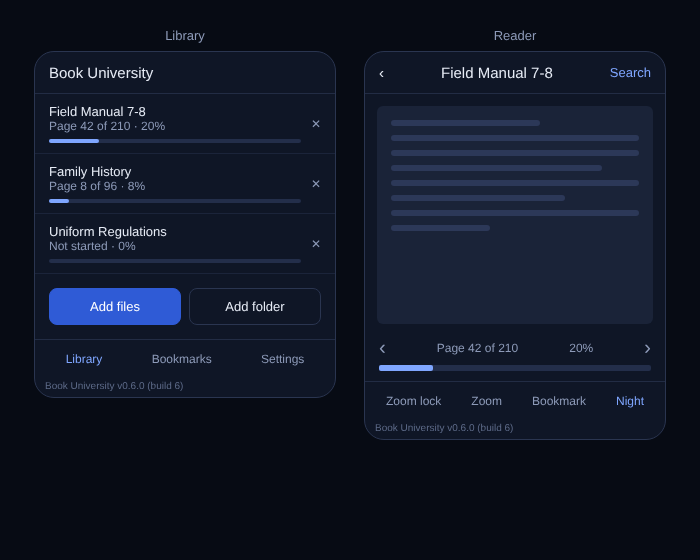

First Android release of Book University: an offline, private PDF reader. No accounts, no tracking, no network access.

**Added**
- Library: add many PDFs at once (files or a whole folder). PDFs are copied into the app's own storage, and the last page read is remembered per PDF.
- Progress bars: a reading progress bar for each PDF in the library and in the reader.
- Reader: page view, scrolling, zoom with typed zoom (25 to 400), zoom lock, search, bookmarks, and Night mode.
- Bookmarks tab: every bookmark from every PDF in one list.
- Settings: version and an Open GitHub Releases button for updates.

**Updated mockups**

Install: download the APK below from this release.
